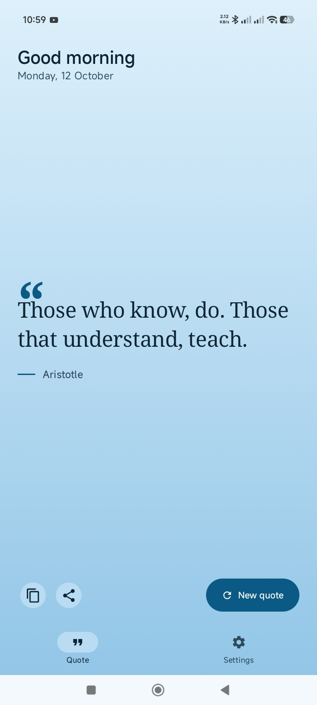
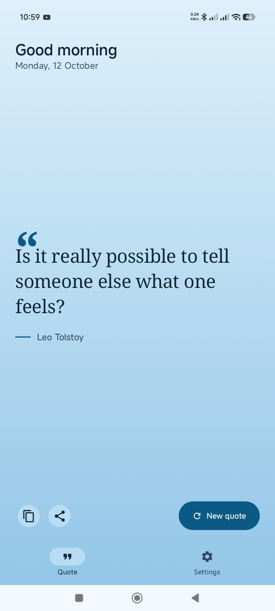
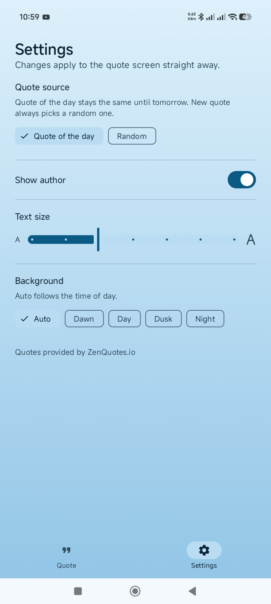

# Daily Quotes

> A calm, minimal Android utility app that delivers a thoughtful quote every day, built with Kotlin and Jetpack Compose.


**Course:** CP3406 / CP5307 Mobile Computing, James Cook University
**Assessment:** Assessment 1, Utility App

---

## Table of contents

1. [Overview](#overview)
2. [Screenshots](#screenshots)
3. [Features](#features)
4. [How it works](#how-it-works)
5. [Tech stack](#tech-stack)
6. [Getting started](#getting-started)
7. [Usage guide](#usage-guide)
8. [Design decisions](#design-decisions)
9. [Roadmap](#roadmap)
10. [Attribution](#attribution)
11. [Author](#author)

---

## Overview

**Daily Quotes** is a focused utility app: open it, read one good quote, and get on with your day. There is no feed, no account and no clutter. The screen greets you according to the time of day, shows the date, and puts a single quote front and centre in a readable serif typeface.

The app is built for people who want a small daily moment of reflection without another app competing for their attention. Everything is adjustable from a single Settings screen, and changes take effect on the quote screen immediately.

## Screenshots

<table>
  <tr>
    <td align="center"><b>Quote of the day</b></td>
    <td align="center"><b>Random quote</b></td>
    <td align="center"><b>Settings</b></td>
  </tr>
  <tr>
    <td></td>
    <td></td>
    <td></td>
  </tr>
</table>

## Features

### Quote screen
- **Time-aware greeting** with the current date (for example, "Good morning, Monday 12 October").
- **Quote of the day** that stays the same until tomorrow, so the app feels consistent across the day.
- **New quote** button that fetches a fresh random quote on demand.
- **Copy to clipboard** in one tap.
- **Share** a quote through the Android share sheet.
- **Large serif typography** with a decorative quotation mark and author attribution for a clean, editorial look.

### Settings screen
- **Quote source:** choose between *Quote of the day* and *Random*.
- **Show author:** toggle author attribution on or off.
- **Text size:** adjust the quote size with a stepped slider (small "A" to large "A").
- **Background:** pick *Auto*, *Dawn*, *Day*, *Dusk* or *Night*. Auto follows the time of day.
- **Live preview:** settings apply to the quote screen straight away.

### Navigation
- Material 3 bottom navigation bar with two destinations: **Quote** and **Settings**.

## How it works

| Mode | Behaviour |
| --- | --- |
| **Quote of the day** | The same quote is shown until the date changes. |
| **Random** | Every tap on **New quote** returns a different random quote. |

The background gradient adapts to the selected theme. In **Auto** mode it changes with the time of day (dawn, day, dusk, night), so the app always feels in step with the hour.

Quotes are retrieved from the [ZenQuotes](https://zenquotes.io/) API over the network.

## Tech stack

| Area | Technology |
| --- | --- |
| Language | Kotlin |
| UI toolkit | Jetpack Compose |
| Design system | Material 3 |
| Navigation | Bottom navigation with Quote and Settings destinations |
| Data source | ZenQuotes REST API |
| IDE | Android Studio |

## Getting started

### Prerequisites
- [Android Studio](https://developer.android.com/studio) (latest stable release recommended)
- Android SDK with a recent API level installed through the SDK Manager
- An Android emulator or a physical device with USB debugging enabled
- An internet connection (needed to fetch quotes)

### Run the app

```bash
# 1. Clone the repository
git clone https://github.com/Kingkhorey/UtilityApp.git

# 2. Open the project folder in Android Studio
#    File > Open > select the UtilityApp folder

# 3. Let Gradle sync finish, then press Run (Shift + F10)
```

### Build from the command line

```bash
./gradlew assembleDebug
```

The debug APK is generated in `app/build/outputs/apk/debug/`.

## Usage guide

1. **Open the app** to see today's quote with a greeting for the time of day.
2. Tap **New quote** to load a different one.
3. Use the **copy** or **share** buttons to keep or send a quote.
4. Open **Settings** to switch between *Quote of the day* and *Random*, hide the author, resize the text, or change the background.
5. Return to the **Quote** tab. Your changes are already applied.

## Design decisions

- **One purpose, one screen.** The quote is the focus, and everything else stays out of the way.
- **Readability first.** A serif typeface, generous spacing and a text size slider keep quotes comfortable to read for everyone.
- **Calm visuals.** Soft gradients that follow the time of day make the app feel alive without being distracting.
- **Immediate feedback.** Settings update the quote screen straight away, so users see the effect of every change.
- **Familiar patterns.** Material 3 components and bottom navigation keep the app intuitive on Android.

## Roadmap

- [ ] Offline fallback with cached quotes
- [ ] Daily notification with the quote of the day
- [ ] Favourite and save quotes
- [ ] Home screen widget
- [ ] Additional typefaces and colour themes

## Attribution

Inspirational quotes provided by [ZenQuotes.io](https://zenquotes.io/).

## Author

**Abdul Khalid Akorede Kazeem**
James Cook University, Bachelor of Information Technology
GitHub: [@Kingkhorey](https://github.com/Kingkhorey)

---

<sub>Built for CP3406 / CP5307 Assessment 1 at James Cook University.</sub>
